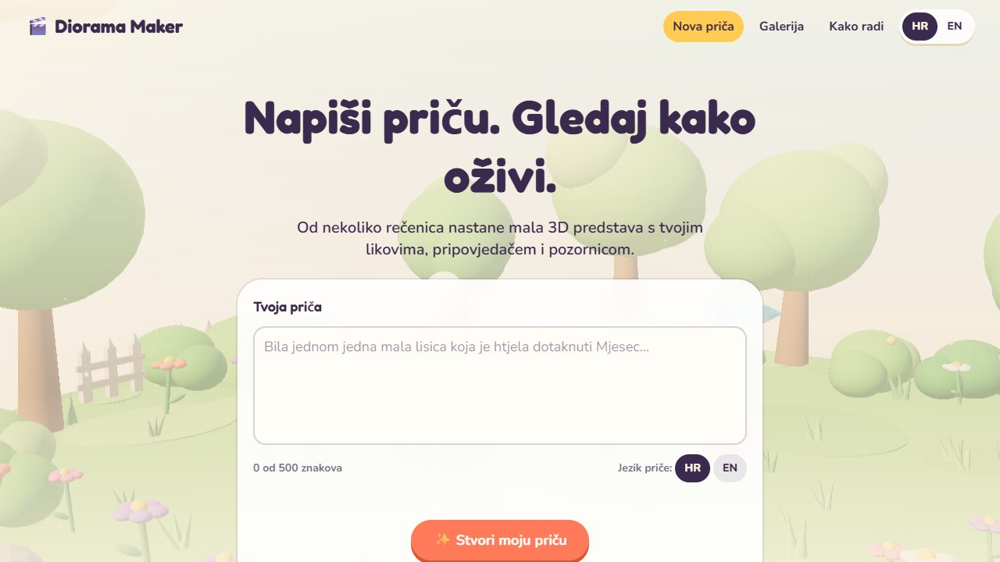
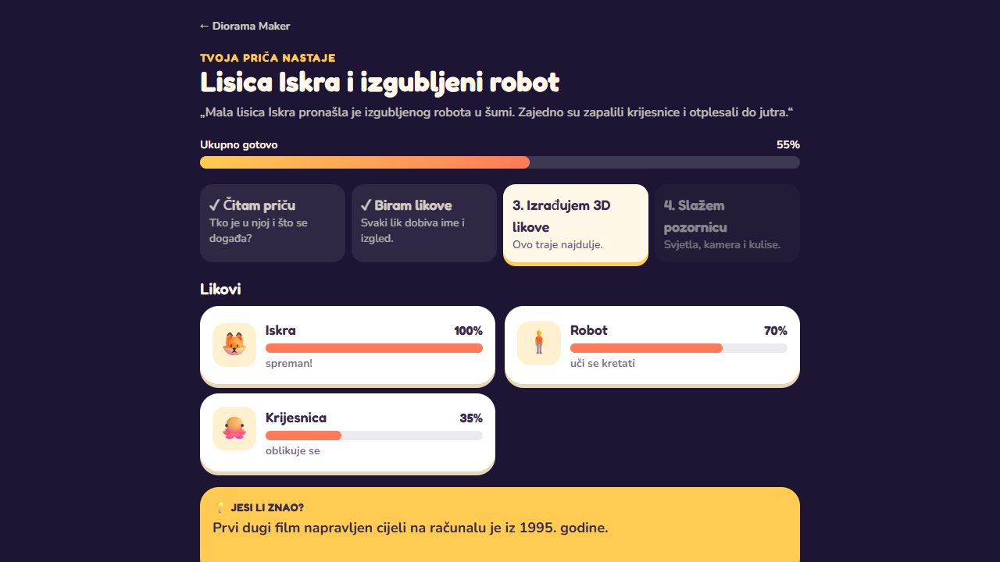
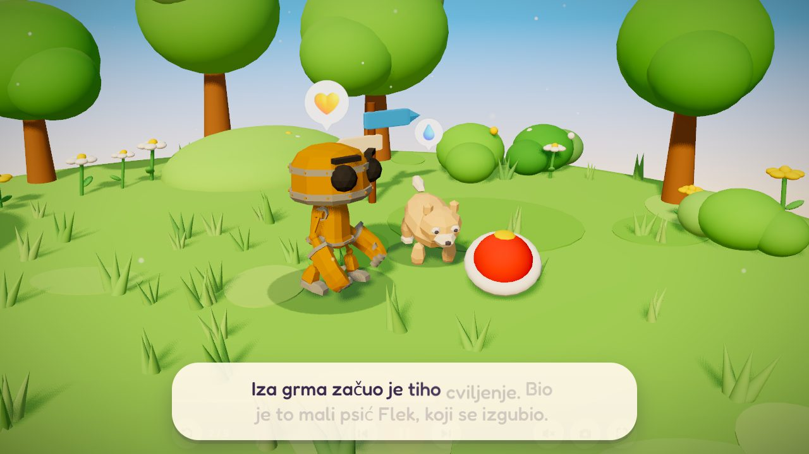
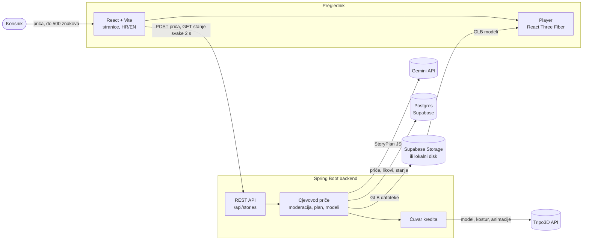

# Diorama Maker

Napiši kratku priču (do 500 znakova, na hrvatskom ili engleskom) i gledaj kako oživi kao mala animirana 3D slikovnica u pregledniku: Gemini od priče napravi scenarij i pripovjedačev glas, Tripo3D izradi 3D modele likova, a Three.js odigra predstavu sa zvukom, titlovima i kamerom.

Sve radi na besplatnim razinama usluga (0 €). Bez ijednog ključa aplikacija radi u *mock* načinu, s ugrađenim primjerima modela.

| Početna stranica | Čekanje dok priča nastaje | Player |
|---|---|---|
|  |  |  |

## Kako radi

1. Korisnik pošalje priču. Backend je provjeri (duljina, moderacija, dnevno ograničenje po IP adresi) i odmah vrati kratku adresu priče (`/s/<slug>`).
2. **Gemini** priču pretvara u *StoryPlan*: JSON s likovima, scenama, okolišem, dobom dana, vremenom, radnjama, kamerom i tekstom pripovjedača. Odgovor je vezan JSON shemom i dodatno se provjerava na backendu. Ako Gemini nije dostupan, plan složi ugrađeni offline planer.
3. **Tripo3D** za svaki lik izradi 3D model iz teksta. Dvonošci dobivaju kostur i pet animacija, četveronošci hod, a ostali ostaju statični. Čuvar kredita prije svakog koraka provjeri stanje i po potrebi smanji opseg (manje animacija → bez kostura → zamjenski model).
4. Modeli se spremaju u **Supabase Storage** (ili na lokalni disk u mock načinu), a stanje priče u **Postgres**.
5. Frontend svake 2 sekunde pita za stanje i prikazuje napredak po likovima. Kad je priča gotova, **player** je odigra: okoliš i rekviziti nastaju proceduralno, a likovi se kreću po vremenskoj crti iz plana.



## Što još zna

- **Pravi likovi i bez Tripa.** U mock načinu backend za svakog lika bira najsličniji od 55 low-poly modela (životinje, ljudi, bića iz bajki, vozila, predmeti; Quaternius, CC0). Bira po opisu lika na engleskom i po imenu lika na hrvatskom ili engleskom, pa lisica, djevojčica i zmaj više nisu isti robot. Modeli već imaju animacije hodanja i mirovanja; ako ništa ne odgovara, ostaju četiri stara primjera.
- **Zvuk.** Svako mjesto ima tihu pozadinu (vjetar, valovi, šuma), vrijeme donosi kišu, vjetar ili daleku grmljavinu, a uz to su ptice, cvrčci, galebovi, mjehurići, koraci i zvončići za čarobne trenutke. Sve se stvara u kodu (Web Audio), bez zvučnih datoteka. Zvuk kreće tek nakon klika na „Pokreni priču”, poštuje gumb za zvuk, utiša se dok pripovjedač govori i pretapa se između scena.
- **Pravi glas pripovjedača.** Dok nastaju modeli, backend pripovijest svake scene izgovori Gemini glasom (besplatna razina, `gemini-3.8-flash-tts`, glas Kore) i spremi snimke uz modele. Player ih pušta, a ako snimka ne postoji ili ne krene, scenu čita glas preglednika. Titlovi prate onaj glas koji govori.
- **Prave sličice u galeriji.** Kad autor prvi put pogleda svoju priču, player snimi jedan kadar i pošalje ga kao sličicu. Server prima samo jednu sliku po priči i samo uz jednokratni ključ koji je dobio preglednik koji je priču napravio. Sliku provjeri, ponovno nacrta kao JPEG 480×270 i, kad je Gemini uključen, provjeri je li prikladna za djecu.
- **Isprobaj drugačije.** Na kraju priče možeš je vidjeti na drugom mjestu, u drugo doba dana ili po drugom vremenu. To samo mijenja plan, bez Geminija i bez novih modela, pa ima svoje dnevno ograničenje (20). Možeš i tražiti da se priča ponovno osmisli; to se broji kao nova priča.
- **Preuzmi video.** Gumb na kraju priče još je jednom odigra i snimi u MP4 ili WebM (do 1280×720), sa zvukom i titlovima, bez gumba na ekranu. Preglednici koji to ne mogu dobiju jasnu poruku.
- **CI i objava.** GitHub Actions na svaki push pokreće sve provjere backenda i frontenda. Postavke za besplatnu objavu (Netlify za frontend, Render za backend, postojeći Supabase) i točni koraci su u [docs/DEPLOY.md](docs/DEPLOY.md).

## Tehnologije

| Dio | Što se koristi |
|---|---|
| Backend | Java 21, Spring Boot 3.5, JdbcClient (obični SQL), Flyway, Maven wrapper |
| Frontend | React 19, TypeScript, Vite, React Three Fiber + drei + postprocessing, Tailwind 4, zustand, motion |
| Baza i datoteke | Supabase Postgres i Storage (besplatna razina); u Dockeru lokalni Postgres |
| Vanjski API-ji | Google Gemini (plan priče), Tripo3D v3 (modeli, kostur, animacije) |
| Testovi | JUnit s ugrađenim Postgresom, Vitest, Playwright |

## Pokretanje

### Najbrže: Docker

```powershell
docker compose up --build
```

Otvori http://localhost:5173. Ne treba nijedan ključ: bez datoteke `.env` backend radi u mock načinu (offline planer, primjeri modela, lokalni Postgres). Ako `.env` postoji, koriste se ključevi iz nje, npr. `GEMINI_API_KEY` za prave planove priča.

### Razvojno okruženje

Preduvjeti: JDK 21 ili noviji (Maven dolazi kroz `mvnw`), Node.js 22 ili noviji te računi za Tripo3D, Google AI Studio i Supabase.

1. Kopiraj `.env.example` u `.env` i upiši vrijednosti. Datoteka `.env` se ne commita. Komentari smiju biti samo u vlastitom retku, bez navodnika i obrnutih kosih crta, jer istu datoteku čitaju i Node i Spring.
2. Provjeri ključeve iz korijena projekta. Skripte ispisuju samo stanje (npr. broj kredita), nikad same ključeve:

   ```powershell
   npm install
   npm run verify
   ```

3. Pokreni backend na http://localhost:8080 (sam učita `../.env`):

   ```powershell
   cd backend
   .\mvnw.cmd spring-boot:run
   ```

   Provjera: `curl.exe localhost:8080/api/health` vraća `{"status":"ok", ...}` s trenutnim načinom rada.

4. Pokreni frontend na http://localhost:5173 (prosljeđuje `/api` na 8080):

   ```powershell
   cd frontend
   npm install
   npm run dev
   ```

Player se može gledati i bez backenda, na ugrađenim pričama: http://localhost:5173/dev/player?story=mock-robot.

### Mock i live način

`TRIPO_MODE=mock` je zadana vrijednost: ne zove Tripo i ne troši kredite, a likovi dobivaju najsličniji model iz ugrađene knjižnice (vidi gore). `TRIPO_MODE=live` troši prave kredite (statični model 20, četveronožac s hodom 55, potpuno animirani dvonožac 95). Prije pokretanja provjeri stanje s `npm run verify:tripo`; backend ionako ne troši više od onoga što je na računu.

## Provjere

```powershell
cd backend; .\mvnw.cmd -q -B verify
cd ..\frontend; npm run build; npm run lint; npm test
npm run smoke
```

`npm run smoke` su Playwright testovi koji u pravom pregledniku prođu put od obrasca preko zaslona čekanja do playera, navigaciju, promjenu jezika i stranice s greškama. Testovi nikad ne zovu vanjske API-je. Uz pokrenut razvojni poslužitelj postoje i `npm run playthrough` (cijela priča u pregledniku) te `npm run shots` (snimke zaslona playera za vizualnu provjeru). Uz pokrenut backend: `node scripts/audio-check.mjs` (stanje zvuka i glasa tijekom priče), `scripts/thumbnail-check.mjs` (sličica od obrasca do galerije), `scripts/tweak-check.mjs <slug>` i `scripts/video-check.mjs <slug>` (snimi video i provjeri da se reproducira). Provjere s početka ovog poglavlja pokreće i GitHub Actions (`.github/workflows/ci.yml`).

## API backenda

| Metoda | Putanja | Što radi |
|---|---|---|
| `POST` | `/api/stories` | prima `{"text": "...", "lang": "hr" \| "en"}`, vraća `202` i `slug` |
| `GET` | `/api/stories/{slug}` | stanje priče, napredak po likovima i, kad je gotova, plan i adrese modela |
| `GET` | `/api/stories?limit=12` | javne priče za galeriju, najnovije prve |
| `POST` | `/api/stories/{slug}/variants` | nova priča od gotove: `tweak` (mjesto, doba dana, vrijeme) ili `retry` (ponovno osmisli) |
| `PUT` | `/api/stories/{slug}/thumbnail` | sličica za galeriju (JPEG ili PNG do 200 KB, uz `X-Upload-Token`) |
| `GET` | `/api/health` | stanje i način rada (mock ili live) |
| `GET` | `/api/credits` | stanje Tripo kredita; samo lokalno ili uz `X-Admin-Token` |
| `GET` | `/api/files/**` | modeli s lokalnog diska (mock način) |

Puni ugovor s primjerima odgovora i greškama je u [docs/API_NOTES.md](docs/API_NOTES.md), poglavlje 4.

## Struktura projekta

```
backend/    Spring Boot aplikacija (paket hr.fesb.diorama), Flyway migracije, primjeri modela za mock način
frontend/   React aplikacija: stranice, i18n (HR/EN), player (src/player), Playwright i Vitest testovi
scripts/    Node skripte za provjeru ključeva (ne ispisuju tajne)
docs/       specifikacija, bilješke o API-jima, snimke zaslona
bruno/      Bruno kolekcija za ručno isprobavanje Tripo API-ja
```

Stanje projekta i odluke: [PROGRESS.md](PROGRESS.md). Specifikacija: [docs/DIORAMA_SPEC.md](docs/DIORAMA_SPEC.md).

## Poznata ograničenja

- **Prava (live) Tripo priča još nije odigrana.** Račun ima 0 kredita, a najmanja nadoplata izlazi iz budžeta od 0 €. Live put je pokriven testovima prema lažnom Tripo poslužitelju, ali nije potvrđen na pravom API-ju. Sve snimke zaslona su iz mock načina. Koraci za live pokretanje su u [NEEDS_OWNER.md](NEEDS_OWNER.md).
- Docker postavke nisu izgrađene na razvojnom računalu (na njemu nema Dockera), pa su provjerene samo čitanjem.
- Nema korisničkih računa: polica „Tvoje priče” živi u `localStorage` preglednika.
- Zvuk i glas pripovjedača provjereni su kroz stanje playera (što svira i kolika je glasnoća dok pripovjedač govori), a ne slušanjem. Hrvatski Gemini glas provjeren je tako da ga je Gemini prepisao natrag u tekst bez uvida u izvornik: prepoznat je kao hrvatski, uz pokoju krivo shvaćenu riječ.
- Glas preglednika (kad priča nema Gemini glas) ne može se snimiti u video; tada video ima titlove bez pripovjedača. Snimanje videa provjereno je u Chromiumu, ne u Safariju ni na mobitelu.
- Priče bez sličice (starije, ili one koje autor nije pogledao) i dalje se u galeriji crtaju iz okoliša i palete.
- Objava na pravu domenu pripremljena je, ali nije napravljena: račune na Netlifyju i Renderu otvara vlasnik ([docs/DEPLOY.md](docs/DEPLOY.md)).

## Bruno kolekcija

Otvori mapu `bruno/` u Brunu, odaberi environment `local` i u njemu upiši `tripoApiKey`. To je secret varijabla, pa vrijednost ne završava u repozitoriju. Zahtjev 0 samo čita stanje kredita. Zahtjev 1 troši prave kredite. Zahtjev 2 ponavljaj dok status ne bude `success`, a zatim odmah pokreni zahtjev 3 jer poveznica na model istječe za 5 minuta.

## Zasluge

Svi modeli za mock način su pod licencom CC0 1.0: knjižnica likova je Quaterniusova (preuzeta s poly.pizza), a robot „RobotExpressive” su napravili Tomás Laulhé i Don McCurdy. Izvor svakog modela je u [frontend/public/mock/CREDITS.md](frontend/public/mock/CREDITS.md). Zvukovi se stvaraju u kodu (vlastiti rad, CC0).
